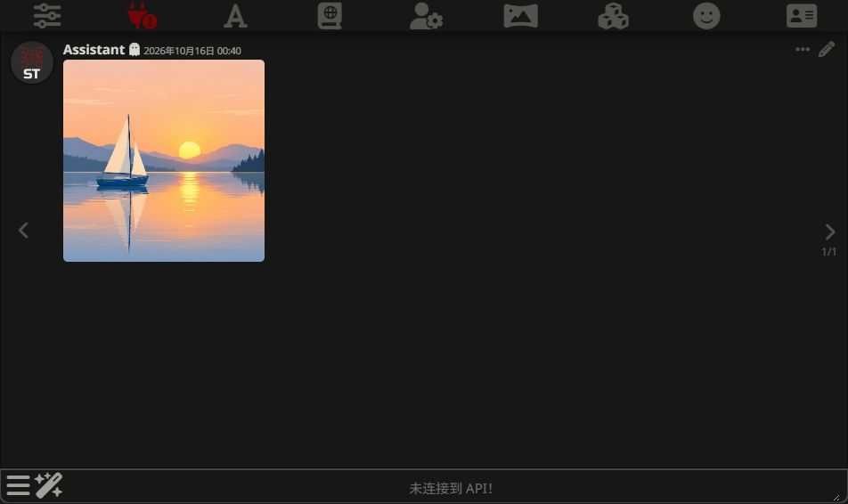

# Codex subscription image generation

This feature adds text-to-image generation to SillyTavern-Subscriptions using
the image tool exposed by a signed-in Codex CLI. The result is uploaded to
SillyTavern's image storage and saved as a message in the current chat.

It is available on the unreleased `codex/image-generation` branch. No upstream
release or pull request is implied by the version number `3.2.0`.

## What changes for users

| Before | With this branch |
| --- | --- |
| Codex subscription requests produce text replies | A separate image path produces an actual image |
| No subscription image controls in the panel | An Images section with a prompt, Generate image and Cancel image |
| No Codex image slash command | `/codex-image <description>` saves the result in chat |
| Chat-completion endpoints only | Image-generation endpoints for the panel and direct HTTP clients |

The image path always requires a ChatGPT login, even if the panel's text-chat
backend is set to Auto or API. It does not use the Custom API key or retry
through an API-key backend. Requests consume the account's Codex allowance;
availability and limits depend on the account and service.

## Install this branch

You need Git, the existing SillyTavern server-plugin prerequisites, and a Codex
CLI/account that reports image-generation capability. The live check used
Codex CLI **0.162.1** on Windows. This is a verified version, not a claim that
every earlier or later version supports the same experimental protocol.

1. As the OS user running SillyTavern, install/update Codex and sign in:

   ```bash
   npm install -g @openai/codex
   codex login
   ```

2. For a fresh server-plugin installation, run from the SillyTavern folder:

   ```bash
   git clone --branch codex/image-generation https://github.com/chzhong628/SillyTavern-Subscriptions.git plugins/SillyTavern-Subscriptions
   cd plugins/SillyTavern-Subscriptions
   npm install
   ```

   If the plugin is already installed, check that its working tree is clean
   (`git status`) and fetch this branch instead of cloning over it:

   ```bash
   git fetch https://github.com/chzhong628/SillyTavern-Subscriptions.git codex/image-generation
   git switch -c codex/image-generation FETCH_HEAD
   npm install
   ```

   If that local branch already exists, switch to it and review/update it
   instead of running `git switch -c` again. These commands keep the existing
   origin remote; fetch the fork explicitly when updating this preview.

3. In SillyTavern's `config.yaml`, set `enableServerPlugins: true`. For a
   controlled preview, set `enableServerPluginsAutoUpdate: false` so startup
   does not attempt to update a feature checkout from its existing remote.

4. Install the panel through **Extensions → Install extension** using the fork
   URL `https://github.com/chzhong628/SillyTavern-Subscriptions`. Then locate
   its installed Git folder (normally under
   `data/<user>/extensions/SillyTavern-Subscriptions`) and run the existing
   installation fetch/switch commands above there too; the panel must also
   be on `codex/image-generation`. The fork's default branch alone does not
   select this feature. A panel-only installation cannot run the server route.

5. Restart SillyTavern and hard-refresh the browser. Confirm the Subscriptions
   panel shows version **3.2.0** and the Images section. If the server plugin
   manages a fallback panel copy automatically, it copies the files from its
   own branch; an independently installed panel still needs step 4.

Do not install duplicate server-plugin copies: they would compete for the
same listener port. Keep existing text-chat settings as desired; the image
panel does not require pressing the text connection's Connect button.

## Generate and save an image

1. Open a character or group chat.
2. Open **Extensions → Subscriptions → Images — Codex subscription**.
3. Enter an image description and press **Generate image**.
4. Wait for the image to appear in the current chat. SillyTavern stores the
   image and chat message, so reopening the chat retains the result.

Alternatively, enter this into the chat command input:

```text
/codex-image A small blue sailing boat on a calm lake at sunrise, simple flat illustration, square composition. Generate exactly one image.
```

The slash command returns the saved image URL for command pipelines. Both
entry points use the same generation/upload/persistence helper. Cancel image
or cancelling the slash-command execution interrupts the pending request.
Cancellation cannot refund allowance already spent. The backend generation
deadline is ten minutes; a reverse proxy may need a longer response timeout.

If you switch chats while waiting, the result is not posted into the newly
selected chat. If a switch occurs during upload, an uploaded file can remain
without a chat message. A failed upload or chat save is reported as an error;
generation itself may already have consumed allowance.

## Actual output example

The following image was generated through the SillyTavern panel, using the
ChatGPT subscription path, on **2026-10-15**. Its exact input was:

> A small blue sailing boat on a calm lake at sunrise, simple flat illustration, square composition. Generate exactly one image.


This run returned a **1254 × 1254 PNG**. Those dimensions describe this
example; the endpoint does not guarantee a requested pixel size. The selected
Codex orchestration model was `gpt-6.1-sol`. This identifies the chat model
invoking the image tool, not the underlying image model.



The screenshot shows the saved image in a real Assistant chat. The text API
was disconnected during this test: image generation uses its own route.
The chat was reopened after a browser refresh and the stored image loaded
successfully. Outputs vary between requests; this example is not a fixture
returned by the implementation.

## Scope and limitations

| Capability | Current behavior |
| --- | --- |
| Text-to-image | One result per request (`n: 1`) |
| Output | Base64 PNG, JPEG or WebP, determined from returned bytes |
| Prompt | Non-empty text, at most 32,000 characters |
| Composition, style, aspect ratio | Describe them in the prompt; no exact guarantee |
| Size and quality fields | Omit them or use `auto`; explicit values are rejected |
| Seed, negative prompt, transparent background control | Not exposed |
| Image input, editing, variations, batches, streaming | Not supported |
| Native SillyTavern `/imagine` / Image Generation source picker | Not integrated; use this panel or `/codex-image` |
| Claude/Gemini image generation | Not added by this change |
| API-key fallback | Never attempted on the image path |

The `codex-image` alias selects the default available Codex chat model from
the account's live catalog. Direct clients may select another available
Codex chat model explicitly. `gpt-image-*` API model names do not select a
subscription image model here. Image turns currently use low reasoning effort
and do not inherit the panel's text-chat effort, verbosity or service tier.

## HTTP reference

| Route | Access |
| --- | --- |
| `POST http://127.0.0.1:8901/v1/images/generations` | Existing standalone listener access controls |
| `POST http://127.0.0.1:8901/codex/v1/images/generations` | Same image handler |
| `POST /api/plugins/subscriptions/images/generations` | Same-origin SillyTavern authentication and CSRF headers |

The panel uses the same-origin route, so a remote browser does not need to
reach the server's loopback listener directly. Direct listener clients use
the existing Host allowlist and, for a non-loopback bind, configured
`X-Subscriptions-Token`. Do not expose the listener just to use the panel.

Example request body:

```json
{
  "model": "codex-image",
  "prompt": "A small blue sailing boat on a calm lake at sunrise, flat illustration",
  "n": 1,
  "response_format": "b64_json"
}
```

For example, save that body as `image-request.json`, then call the local
listener and write its response without printing the base64 to the terminal:

```bash
curl --fail-with-body http://127.0.0.1:8901/v1/images/generations -H "Content-Type: application/json" --data-binary @image-request.json --output image-response.json
```

Successful response shape (placeholder data below is abbreviated):

```json
{
  "created": 1792053623,
  "data": [{ "b64_json": "<base64 image bytes>", "format": "png" }],
  "codex_model": "gpt-6.1-sol"
}
```

`created` is Unix seconds. `format` and `codex_model` are plugin extensions
to the OpenAI-style response; `revised_prompt` is included when the tool
provides it. Direct HTTP clients receive image data only: they must save it
themselves. The panel performs the additional SillyTavern upload and chat save.

Errors use `{"error":{"message":"..."}}`. Invalid inputs, unsupported
controls, unavailable models or subscription-login guard failures return
400; quota exhaustion can return 429; model rerouting returns 422; unavailable
image capability returns 503; missing/invalid image results or forbidden
tool attempts return 502; the generation deadline returns 504. Other CLI or
transport failures retain their handler status. No image result is replaced
by a successful text response or an API-key retry.

## Troubleshooting

- **Images section missing:** update both server and panel checkouts to the
  branch, restart and hard-refresh; check for an older duplicate panel.
- **Image capability unavailable:** update the Codex CLI used by the server
  and check that this account exposes image generation. Being able to send
  text with Codex does not prove image capability.
- **Not signed in with a ChatGPT account:** run `codex login` as the server's
  OS user, or set `ST_SUBSCRIPTIONS_CODEX_HOME` to the signed-in home. An
  API-key login is intentionally refused on this route.
- **Non-OpenAI endpoint / global AGENTS.md refused:** use the existing
  subscription isolation setup described in the [README](../README.md#troubleshooting).
- **Turn completes without an image:** retry with an explicit image
  description, or inspect the returned error. There is no text-to-image API
  fallback and no automatic second image request.
- **Image generation succeeds but upload/save fails:** check SillyTavern's
  image-upload response, user storage and chat-save errors. Avoid immediately
  repeating generation when only persistence failed.

## Implementation and verification

Image requests use a separate persistent Codex app-server instance with the
experimental API capability enabled and only image generation enabled among
the isolated optional tools. Text chat keeps its original tool-disabled
instance. Image turns are ephemeral and read-only, refuse shell, file editing,
MCP, web search and subagents, validate returned image bytes (maximum 30 MiB),
and do not read tool-provided filesystem paths or download returned URLs.
See [DESIGN.md](DESIGN.md#codex-image-generation) for the request flow.

Automated checks are offline and do not spend subscription allowance:

```bash
node --test test/images.test.js
npm test
```

The verification run for this branch passed **211 tests**, including the
SillyTavern YAML integration checks enabled with `ST_ROOT` pointing to a
SillyTavern checkout. The image-specific suite has **12 tests** covering
validation, image decoding, process configuration, login/endpoint guards,
capability/model selection, quota/tool/reroute errors, cancellation races,
deadlines, HTTP disconnects, upload/persistence and chat-switch protection.
These use fake protocol/HTTP/UI objects; they do not prove live account
availability or replace browser testing.

Live verification on Windows used SillyTavern 1.19.0 and Codex CLI 0.162.1: an actual subscription
image result was received, the panel generated and uploaded the example
above, and the saved chat/image survived reopening after refresh. A live
slash-command invocation, live group chat, remote-browser setup and image
generation on Linux/macOS/Termux have not been verified. They should be
checked by contributors on those environments before broader release.
