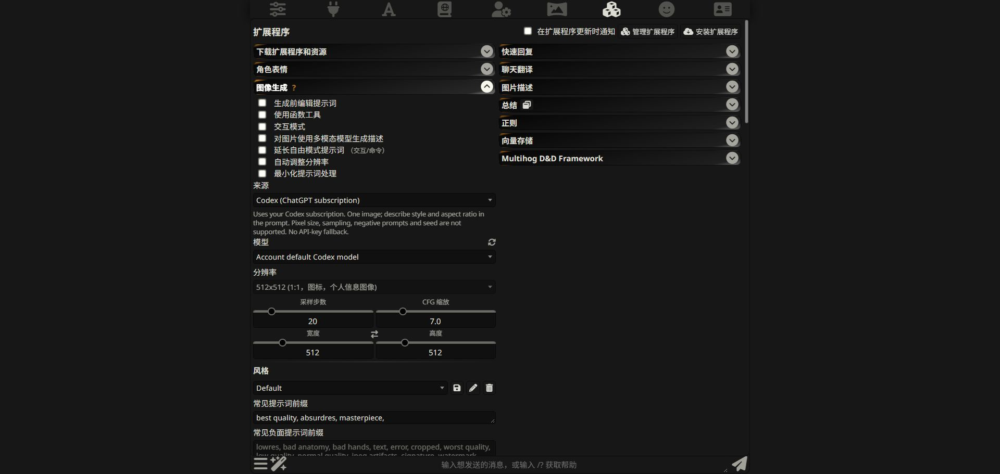
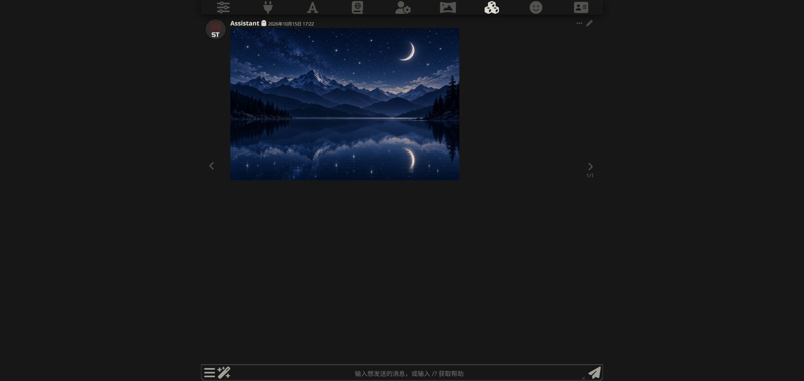
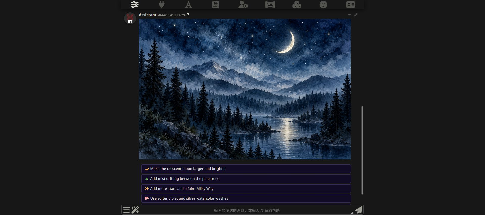

# Native SillyTavern image generation with Codex

Version 3.3.0 adds a bridge from SillyTavern's built-in **Image Generation**
extension to the Codex subscription image endpoint. With the companion core
patch installed, Codex appears in the normal Source dropdown and participates
in `/imagine`, image buttons, interactive mode and the `GenerateImage` tool.

## Why there are two parts

The current SillyTavern 1.19.0 source list is hardcoded. Updating only this
extension cannot register another source. The companion patch adds a generic
provider registration interface to SillyTavern; Subscriptions then registers
`subscriptions:codex`. It does not replace an existing provider, intercept
global fetch, or insert an API key to bypass another source's checks.

This is a preview integration: **the companion patch is required on stock
SillyTavern**. It has not been merged upstream. The standalone Images panel
and `/codex-image` remain available without the patch. The plugin never
modifies SillyTavern core files automatically on startup.

## Install

1. Follow [the image guide](CODEX_IMAGES.md#install-this-branch) to install
   both server and panel from `codex/image-generation`. Their current preview
   version should be **3.3.0**.
2. Stop SillyTavern. From the Subscriptions repository, run:

   ```bash
   node scripts/install-native-images.mjs /path/to/SillyTavern
   ```

   Windows example:

   ```powershell
   node scripts/install-native-images.mjs "C:\path\to\SillyTavern"
   ```

   The installer runs `git apply --check` before applying
   [`compat/sillytavern-native-images.patch`](../compat/sillytavern-native-images.patch).
   It changes only the native Image Generation `index.js` and adds its
   `providers.js`. The patch was developed against SillyTavern 1.19.0,
   commit `06bde939f`; incompatible/local changes cause a refusal without
   overwriting files. Git must be installed. Re-running is safe when the
   complete patch is already present.
3. Start SillyTavern and hard-refresh the browser. Open **Extensions → Image
   Generation → Source → Codex (ChatGPT subscription)**. Alternatively use
   **Subscriptions → Images → Use native image generation** to select it.



The model entry selects the default Codex chat model for the account. It is
not the name of the underlying image model. Unsupported resolution, sampling,
seed and negative-prompt controls are disabled; describe composition, aspect
ratio and style in the positive prompt. Existing native positive prompt
prefixes and style presets still participate in the prompt.

## Three normal entry points

### Slash commands and image buttons

Open a character or group chat, then use:

```text
/imagine A serene night sky over a mountain lake, stars and a crescent moon, simple illustration.
```

The native extension processes the prompt, calls the registered provider,
uploads the returned image and saves/displays it through its usual pipeline.
Its image buttons, visibility settings, cancellation and swipe handlers use
that same pipeline. Per-image requests still consume subscription allowance.
Other existing source-specific limits continue to apply; this does not make
unsupported Codex pixel-size, editing or seed controls available.



### Plain chat using interactive mode

Enable **Image Generation → Use interactive mode** and leave **Use function
tool** off for this mode. For example, send:

```text
Generate a picture of a night sky.
```

SillyTavern's existing interactive detector recognizes supported phrases and
starts native image generation. It is a phrase detector, not model tool
calling; its existing language/pattern limitations still apply. Keep
**Extend free mode prompts** off if no text API is connected. Enabling that
setting asks your selected text model to expand the prompt first.

### Plain chat using the function tool

1. Enable **Image Generation → Use function tool**.
2. In AI Response Configuration, enable **function calling**. Use a compatible
   prompt post-processing mode (for example None or one of the Tools modes).
3. Connect a tool-capable text model. For Codex subscription text chat, use
   Subscriptions Connect and the **Subscription only** backend.
4. Send a natural-language picture request. The model chooses when to call
   `GenerateImage`; the client executes it using the selected image source.

The Codex subscription text backend now translates the explicitly advertised
`GenerateImage` function into an experimental Codex dynamic tool. When Codex
requests it, the backend interrupts that inference turn and returns an
OpenAI-style `tool_calls` response, in JSON or SSE. SillyTavern executes the
native image tool and supplies its result in a subsequent chat request. The
backend retains that result in the conversation so the assistant can continue
without losing the generated image URL.

Only `GenerateImage` is bridged by this change. Other SillyTavern function
tools are not enabled by it. Shell, web, MCP and file-editing tools remain
disabled. Requests without this advertised function keep the existing text
behavior, and `tool_choice: "none"` prevents this bridge from being enabled.
Selecting a non-Codex native image source makes `GenerateImage` use that
source's normal billing/settings instead; the Codex subscription-only image
guarantee applies specifically to the Codex image source.



## Verified behavior

On Windows, using SillyTavern 1.19.0, the installed Codex CLI reported
`0.162.0-alpha.17.2` during this 2026-10-15 run. The original standalone-image
test used 0.162.1; neither observation establishes a minimum supported version.

- The native Source dropdown displayed Codex and selected its default-model
  alias, with unsupported controls disabled.
- Native `/imagine` generated and saved an actual 1536 × 1024 night-sky PNG.
- A real Codex subscription chat request returned `GenerateImage` as an
  OpenAI-style function call. In the browser, a normal picture request
  invoked that tool, generated a second 1536 × 1024 watercolor image and
  continued with the assistant's reply. Interactive mode was off for this
  tool-calling test.
- Offline coverage checks JSON/SSE tool calls, forbidden/malformed tools,
  result continuation, the native provider adapter and registry, and patch
  installation/reversal/conflict refusal. Run `npm test` with `ST_ROOT` set
  to the patched SillyTavern checkout for companion integration checks.

The final full suite passed **218 tests**, with no failures or skips, with
`ST_ROOT` pointing to the patched checkout. JavaScript syntax checks passed;
the checkout does not have ESLint installed, so the core lint command was
not run successfully.

Live interactive-mode generation, image swipes/buttons, cancellation, group
chats, remote browsers and non-Windows hosts have not each been exercised
in this run. They share the native pipeline but still need broader manual
verification. Native exact-size, seed and image-editing support is not added.

## Updating and removing the companion patch

Before upgrading SillyTavern, review your local diff and remove the patch if
it would conflict with the upgrade:

```bash
node scripts/install-native-images.mjs /path/to/SillyTavern --reverse
```

The reverse operation also checks first and refuses if later edits conflict.
It does not reset other files or remove your chat/image data. After removal,
select another native source or use `/codex-image`. A saved Codex native
selection cannot generate until its provider is installed again.

For upstream contribution, the generic registry patch belongs in SillyTavern;
the Codex provider adapter and tool bridge belong in Subscriptions. A PR to
Subscriptions alone must keep this dependency explicit. No PR has been opened.
